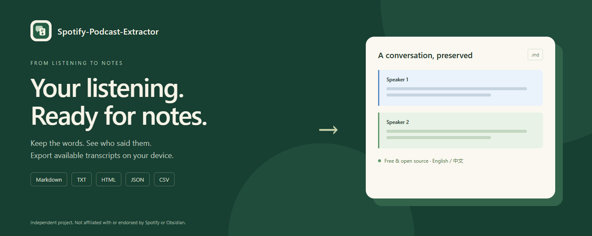
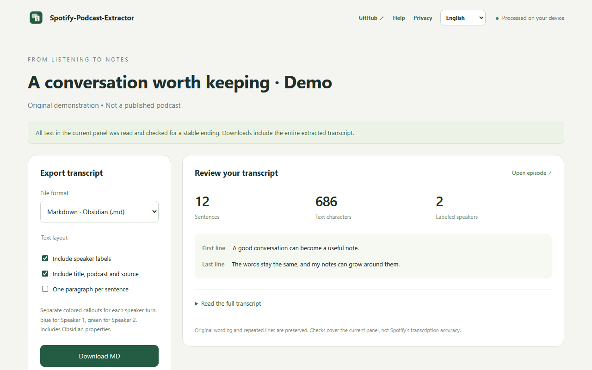

# Spotify-Podcast-Extractor

English · [简体中文](README.zh-CN.md)

**From listening to notes.** Export a Spotify episode's available transcript without losing offscreen text, with clear speaker turns and five download formats.

Free, open source, and processed on your device. The Chrome extension is the first product built from this repository's reusable extraction and export modules.



## Install

**Chrome Web Store: not published yet.** Until the store version is available:

1. Download the `*-manual.zip` asset from [Releases](https://github.com/CN-JJB/Spotify-Podcast-Extractor/releases) and unzip it.
2. Open `chrome://extensions` and enable **Developer mode**.
3. Click **Load unpacked**. Select the extracted `Spotify-Podcast-Extractor` folder containing `manifest.json`.
4. Pin **Spotify-Podcast-Extractor** to the toolbar.

If you cloned this repository, select its `extension/` folder instead. There is no npm build step for installation. Chromium-based Edge can load the same unpacked extension; browser automation is currently verified in Chromium.

## Use

Open a Spotify web-player **episode** with a **Transcript** tab. Click the extension icon, keep the source tab open, and review the sentence count, first and last lines, and full preview. Choose a format and download. The browser's save-location dialog is enabled by default, so you can save Markdown directly into an Obsidian vault.

The interface supports English and Chinese. Changing the interface language does not translate the transcript. No extension account or API key is required; Spotify may require you to sign in to access its page.



| Format | What you get |
| --- | --- |
| Markdown | Obsidian properties, source link, chapters and a labeled callout for each speaker turn |
| TXT | Plain original text, with optional speaker labels and metadata |
| HTML | Self-contained offline reading page; printable through the browser |
| JSON | Sentence records, speakers, chapters, metadata and extraction checks |
| CSV | One sentence per row, UTF-8 BOM and spreadsheet formula protection |

Speaker 1 uses blue callouts; Speaker 2 uses green callouts. Missing speaker information is marked, never guessed.

```markdown
> [!info] Speaker 1
>
> A good conversation can become a useful note.

> [!success] Speaker 2
>
> Keeping each speaker separate helps me follow the exchange.
```

## What “complete” means

The extractor reads `textContent` from the current episode's transcript nodes. It does not use visible-only `innerText`, deduplicate repeated sentences, or cut exports to a preview length. It checks the panel's beginning and ending and waits for stable content. Unknown markup, recycled rows, episode changes and unfinished loading produce an error rather than a success claim.

These checks cover **the available current transcript panel**, not the source audio or unavailable backend content. Spotify controls transcript availability and accuracy. This is not speech recognition, an audio downloader or a translator. SRT/VTT are not generated without real sentence timestamps. Spotify page changes may require an extractor update.

## Privacy and permissions

The release requests only `activeTab`, `scripting` and `downloads`. It reads the episode you choose after you invoke it, generates downloads locally, and monitors only those downloads. No persistent host permissions, analytics, remote scripts, transcript upload, authentication cookies or Obsidian vault access.

Website content and the selected episode URL are still processed user data. Details, retention and contact options are in the [privacy policy](PRIVACY.md). [GitHub Issues](https://github.com/CN-JJB/Spotify-Podcast-Extractor/issues) are public; do not post private transcripts or account information.

## Develop and reuse

Use a current supported Node.js release for development and Python 3 for packaging:

```sh
npm ci --ignore-scripts
npm test
python package.py
```

`extension/extractor.js` exports a self-contained `extractTranscript()` function for execution inside a Spotify episode document. `extension/formats.js` exports `renderExport(transcript, format, options)`, `paragraphs()` and `safeFilename()`; it can run in a browser or Node.js. The extension is the UI around these same modules, with no duplicate extraction implementation.

```js
import {renderExport} from './extension/formats.js';
// transcript is the data returned by extractTranscript, or a previously exported JSON file.
const file = renderExport(transcript, 'md', {language: 'en', speakers: true});
// file: {text, filename, mime}; choose your own file-writing mechanism.
```

| Directory | Purpose |
| --- | --- |
| `extension/` | Chrome product, reusable modules, bundled icons and local help/privacy pages |
| `tests/` | Node regression tests and isolated Chromium acceptance checks |
| `scripts/` | Original artwork and policy generation |
| `store/` | Product design, bilingual listing copy, reviewer notes and store images |
| `docs/` | Compatibility notes and license choice |
| `dist/` | Generated ZIP files; ignored by Git |
| `tmp/`, `outputs/` | Optional local fixtures, browser profiles and user exports; ignored by Git |

To regenerate store screenshots, install Playwright and its Chromium browser separately, then run `npm run preview:store`. If Playwright is outside this project, set `SPOTIFY_TEST_PLAYWRIGHT` to its `index.mjs` absolute path. `python scripts/make-store-art.py` uses Pillow to regenerate icons and the small promotional image. Generated public images are committed, so these tools are optional for normal development.

The browser tests use an isolated profile and original demo text. The optional `tests/browser-smoke.mjs` uses a private local snapshot at `tmp/live-page.json`; that snapshot is intentionally not distributed. A disposable test copy gets a fixture-origin permission for headless injection, while release packages retain only the three permissions above. See [validation notes](docs/experience.md).

## Publish the Chrome product

`python package.py` creates a root-manifest **webstore ZIP** and a separate **manual-install ZIP**. Upload only the `*-webstore.zip` to the Chrome Web Store developer dashboard.

[Publishing guide / 上架操作指南](store/上架操作指南.md) · [Review and privacy fields](store/审核与隐私填写.md) · [Product design](store/产品设计.md)

## License and attribution

[MIT](LICENSE). See the [license choice](docs/license-choice.md). The license covers project code and original artwork, not third-party podcast content or trademarks. Development dependencies retain their own licenses and are not bundled into the extension.

Independent project. Not affiliated with or endorsed by Spotify or Obsidian. Use exported content within your rights and the applicable terms.
